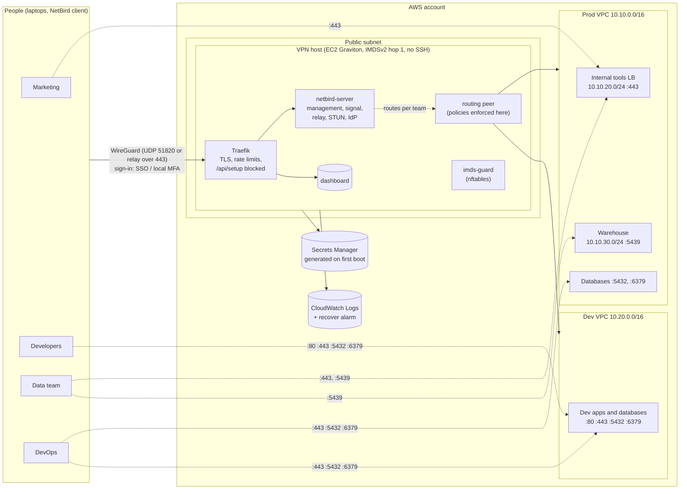

# team-vpn: a self-hosted, team-scoped VPN on AWS with NetBird

A small, production-minded VPN for a company of 10–300 people. Every team gets **only the networks and ports it
needs**, everyone signs in with **SSO or MFA**, and the whole thing is **one Terraform root**: no console clicks, no
long-lived keys, no SSH.

It runs [NetBird](https://netbird.io) (WireGuard-based, open source) with its **embedded identity provider** on a
single hardened Graviton instance, behind Traefik for TLS.

## Architecture



A rendered version for slides and posts is in [`docs/architecture.svg`](docs/architecture.svg).

Dotted lines are **policy**, not just routing: a team's device receives routes only for its networks, and the
routing peer forwards only the ports that team's policy allows. Marketing's laptop doesn't even know the dev VPC
exists.

## What's in the box

| Layer | What it does | Where |
|---|---|---|
| Identity | NetBird's embedded IdP. **User approval required**: a new sign-in waits until an admin approves it and assigns a team. Local accounts use **Local MFA**; staff can use **Sign in with Google** (optional). Every device re-authenticates every 24 h. | `files/vpn-configure` |
| Least privilege | The all-to-all default policy is disabled. One group and one policy per team (`team-<name>`), TCP ports only. One route per network, distributed only to the teams that list it. | `teams` in `terraform.tfvars`, `files/vpn-configure` |
| Edge | Traefik with static routes (never the Docker socket). `/api/setup` blocked publicly; sign-in and device-code endpoints rate-limited; the local password sign-in only from the host itself; optional allowlist for the dashboard and API. | `templates/traefik-dynamic.yaml.tftpl` |
| Safe first boot | The API listens on `127.0.0.1` until the owner account exists; only then are ports 80/443 opened and the certificate requested (new certificates are public in CT logs within minutes). | `files/bootstrap.sh` |
| Secrets | Created empty by Terraform, **generated on the host** on first boot, stored in Secrets Manager. No value passes through Terraform state, a command line or a log. The one-time setup token is deleted at the end of the boot. | `secrets.tf`, `files/bootstrap.sh` |
| Host | Graviton, Amazon Linux 2023, encrypted volume, IMDSv2 with hop limit 1, an nftables guard so nothing arriving through the tunnel or from a container reaches the metadata service, no SSH (Session Manager only), a role that can read only its own secrets and write only its own logs. | `main.tf`, `iam.tf`, `files/vpn-imds-guard` |
| Operations | Container logs to CloudWatch, daily snapshots (14 days), automatic recovery on hardware failure, email alerts. | `ops.tf` |

## Example: four teams

`terraform.tfvars.example`:

| Team | Networks | Ports | Why |
|---|---|---|---|
| marketing | internal tools LB | 443 | CMS and analytics dashboards; nothing else |
| development | dev VPC | 80, 443, 5432, 6379 | Dev apps, dev databases and cache. Nothing in prod |
| data | tools LB, warehouse subnet | 443, 5439 | BI tools and the warehouse |
| devops | prod and dev VPCs | 443, 5432, 6379 | Operating both environments |

A person can be in several teams; their access is the union. Adding a team or a network is a PR to
`terraform.tfvars` plus a re-run of `vpn-configure` (below).

## Deploy

Prerequisites: a VPC with a public subnet, a DNS name you control, Terraform ≥ 1.6, AWS credentials for an admin
role (from your pipeline, ideally via OIDC).

```bash
cd terraform
cp terraform.tfvars.example terraform.tfvars   # edit it
terraform init
terraform plan -out=tfplan
terraform apply tfplan
terraform output elastic_ip
```

1. **DNS:** create an A record `var.domain` → `elastic_ip`, **DNS only** (a proxy/CDN can't carry gRPC, relay
   and STUN). The host waits for it before requesting the certificate.
2. **First boot** takes 5–10 minutes. Follow it in Session Manager:
   `sudo tail -f /var/log/vpn-bootstrap.log`. It ends with `vpn: done`.
3. **Owner account (break-glass):** read the generated password once into your password manager, sign in at
   `https://<domain>`, and register an authenticator app when Local MFA asks:
   ```bash
   aws secretsmanager get-secret-value --secret-id "$(terraform output -raw admin_password_secret)" \
     --query SecretString --output text | pbcopy
   ```
4. **Optional, Google sign-in:** create an OAuth client (consent screen **Internal**), put its client ID in
   `google_client_id`, its secret in `<name>-google-client-secret` (silently, e.g. `read -rs` then
   `--secret-string file:///dev/stdin`), and re-run `vpn-configure`. Then add the redirect URI shown under
   **Settings → Identity Providers** to the Google client.
5. **People:** each person installs the NetBird client and runs `netbird up --management-url https://<domain>`.
   They wait as **pending** until an admin approves them (**Team → Users**) and adds their `team-*` groups.

## Day 2

- **Change teams or networks:** edit `teams`, PR, `terraform apply`. Host files are written by user data on
  **first boot only** (`ignore_changes`, so the host is never replaced by accident), so put the new list on the
  host and re-run the configuration with a 1-day admin token (Team → Users → you → Create token):
  ```bash
  terraform output -raw teams_json          # copy this
  # on the host (Session Manager, sudo -i):
  cat > /opt/vpn/teams.json                 # paste, then Ctrl-D
  /opt/vpn/bin/vpn-configure                # paste the admin token when asked
  ```
  `vpn-configure` adds and updates; it never deletes, so remove a retired route or policy in the dashboard.
- **Offboarding:** block the user in the dashboard the same day. Their devices lose access at once.
- **Upgrade NetBird:** read the release notes, change the image digests in `variables.tf`, then on the host
  `cd /opt/vpn && docker compose pull && docker compose up -d`.
- **Audit:** the dashboard's **Activity** log (who approved whom, group changes, new devices) and the CloudWatch
  log groups `/<name>/*`.

## Known limits (and what to add next)

- **One host.** If it's down, existing tunnels keep working but new sign-ins fail. Next step: a second routing peer
  in another availability zone.
- **No exit node.** A full-tunnel exit node (`0.0.0.0/0`) also covers private ranges, so NetBird's per-route rules
  can't scope it per team; you'd need a per-device firewall on the host fed from the NetBird API. Not included to
  keep this small. Split tunnel (only team networks through the VPN) is the default here.
- **DNS.** Private names are resolved by whatever the client uses. If you want every VPN DNS query logged and
  filtered, add a resolver (e.g. CoreDNS) on the host forwarding to the VPC resolver, pushed as a NetBird
  nameserver group.
- **Peer approval** is a NetBird Cloud feature; self-hosted relies on user approval plus SSO/MFA. Watch the
  Activity log for new devices.
- **Device-code phishing:** never approve a sign-in code someone else sent you; only one your own client just
  showed.

## Cost (rough, verify against current AWS pricing)

t4g.small on-demand plus an Elastic IP is roughly **$15–20 a month**, plus data transfer for relayed traffic.
Most traffic is peer-to-peer WireGuard and never touches the host.

## License

MIT. See [LICENSE](LICENSE).
